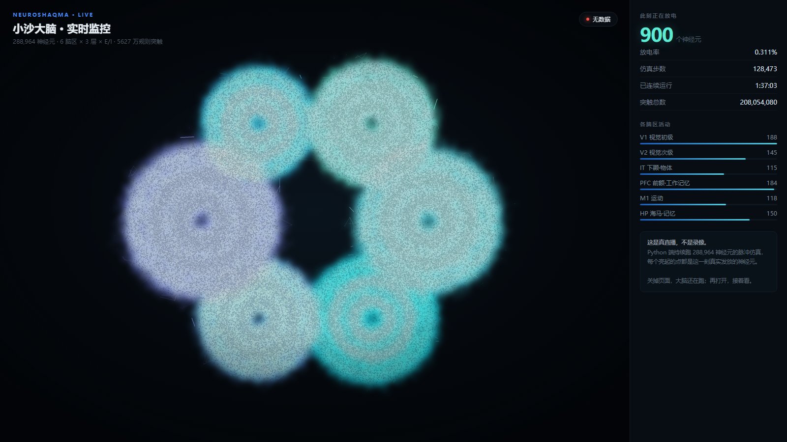

# NeuroShaqma · 小沙大脑 / Xiaosha Brain

  [](https://github.com/haoqinhe8-boop/NeuroShaqma/discussions)

> **我 12 岁。我在家里用一台游戏电脑，造出了一个比果蝇大脑更大的脉冲神经网络大脑——它有 2.08 亿个突触，真的会学习，还已经自己活了 49 天。**
>
> **I'm 12. At home, on a gaming PC, I built a spiking neural network bigger than a fruit fly's brain — 208 million synapses, it really learns, and it's been alive for 49 days.**


### 实时监控 · 真直播（不是录像）



**这是活的**：Python 端持续跑 288,964 个神经元的脉冲仿真（约 23 步/秒），
网页通过 SSE 实时接收，每个亮起的点都是**这一刻真实发放**的神经元。

- **在线看** → https://www.shaqma.chat/brain-live.html
- **自己跑**：`python brain_live.py`（后端仿真）+ `brain-live.html`（前端）

> 技术细节：Canvas 三级渲染（模糊光晕层 / 清晰点阵层 / 神经纤维层）+ 景深分层；
> 因为是闭环 AGC（自动增益控制）把放电率锁在 0.3%，否则这个网络会正反馈爆炸（实测 17% 活跃、单步 1 秒）或迅速静息。
> 关掉网页，大脑还在跑；再打开，接着看。


上面这张动图是它真实仿真时的样子：每一个亮点都是一个神经元在发放脉冲。它平时 99% 的神经元是安静的，只有 0.3% 在放电——就像果蝇那样，用极少能量干很多事。

*The GIF above is a real simulation: each dot is a neuron firing a spike. 99% of its neurons are quiet at any moment, only 0.3% fire — like a fly, doing a lot with very little energy.*

## 作者 / Author

**Peter**，来自上海市宝山区的一名 12 岁初中生。这个项目完全是在家里的台式机上完成的——没有实验室，没有服务器，没有团队。白天上学，晚上回家写代码。

**Peter**, a 12-year-old middle-schooler from Baoshan District, Shanghai. Built entirely on a home PC — no lab, no server, no team.

- **NVIDIA RTX 2080 Ti（11GB）** —— 日常开发、跑 7B 语言模型 / daily dev, runs a 7B LLM
- **NVIDIA RTX 4090（48GB）** —— 跑 72B 大模型和大脑的大规模仿真 / runs a 72B model and large-scale brain sims

## 开发方式（诚实说明）/ How it was built (honest)

这个项目的**主力是 DeepSeek-V4-Pro**：绝大部分的代码编写、调试、实验设计和参数调整都由它完成。Peter 负责提出想法、拍板关键决策并验收结果。所有数字都是在真实机器上真实跑出来的，不是 AI 编的——每个都能用 `demo.py`、`bench.py` 和 `--selftest` 自己验证。

**The main force is DeepSeek-V4-Pro**: most of the coding, debugging, experiment design and tuning. Peter sets the ideas, makes the key calls and checks the results. Every number was really run on real hardware — verify with `demo.py`, `bench.py` and `--selftest`.

## 这是什么 / What is this

小沙大脑是一个**事件驱动的脉冲神经网络**（Spiking Neural Network），模仿真实大脑的工作方式：神经元平时安静，只有膜电位超过阈值时才发放一个脉冲（spike），信号以脉冲事件的形式在突触间传递。它不靠大矩阵乘法堆算力，而是靠**稀疏发放 + 事件驱动**。

An **event-driven Spiking Neural Network** that mimics a real brain: neurons stay silent, fire a spike only when their membrane potential crosses a threshold, and signals travel as sparse spike events — not dense matrix math.

## 小沙大脑 vs 果蝇大脑 / Xiaosha vs Fruit Fly

| 指标 Metric | 小沙 Xiaosha | 果蝇 Fly | 对比 Ratio |
|---|---|---|---|
| 神经元 Neurons | **288,964** | 139,255 | **2.07×** |
| 突触 Synapses | **208,054,080** | ~50,000,000 | **4.16×** |
| 每神经元连接 Connections/neuron | 720 | ~360 | 2× |
| 全系统细胞 Total cells (皮层+小脑+脑干+脊髓+感觉/运动外周) | **3,985,964** | 139,255 | **28.6×** |

> 果蝇数据参考：果蝇大脑约 139,255 个神经元、约 5,000 万突触（连接组学公开数据）。
> *Fly reference: ~139,255 neurons and ~50M synapses (public connectome data).*

## 能干什么 / What it can do（每个数字都是真跑出来的 / every number really ran）

- **会学习 Learns**：R-STDP —— 练完导航任务，成功率从出厂 33% 涨到 93% / navigation success 33%→93%
- **会自我调节 Self-regulates**：稳态发放率 + E/I 平衡，活跃度稳定 0.28% / homeostasis keeps firing at 0.28%
- **跑得动 Fast**：28.9 万神经元 CPU 20.7ms/步（48Hz 实时）、4090 上 7.26ms/步（138Hz）
- **有身体 Has a body**：耳听 / 嘴说 / 鼻闻 / 脚走 / 手抓（hears, speaks, smells, walks, grabs）
- **有内脏 Has organs**：肺呼吸 / 心脏泵血 / 肝肠吸收 / 泌尿清理 / 免疫查 Bug / 内分泌调节

## 实战记录 / Real-world track record（真跑出来的 / really ran）

小沙已经在这个家里真实自主运行了近两个月。以下数字全部来自运行日志，逐条可查。
*It has run autonomously at home for nearly two months. All numbers are from real logs.*

### 1. 自主运行 49 天，5,171 个决策 0 失败 / 49 days, 5,171 decisions, 0 failures

自 2026-09-19 起连续自主运行（计划任务每 10 分钟唤醒，无人值守）：

| 指标 Metric | 数字 Value |
|---|---|
| 自主决策动作总数 Decisions | 5,171 |
| 成功 / 失败 Success / Fail | 5,171 / 0（100%） |
| 自主内容产出 Content produced | 3,396 次 |
| 话题池整理 Topic curation | 1,741 次 |
| 产品制作 Products made | 18 次 |
| 自主发起学习 Self-initiated learning | 13 次 |

### 2. 自学 26.6 万条知识 / 266k items self-learned（158MB）

- 知识库 266,381 条（158MB），全是从网络自己学来的（GitHub/arXiv/CSDN 等公开源）
- 学习日志 21,413 条 / learning log 21,413 entries
- 自己维护的话题池 34,587 个 / 34,587 self-curated topics

### 3. 自主产出与经营 / Autonomous production

- 内容产出日志 59,040 条 / 59,040 production log entries
- 上架作品 4,252 件（"热点速读"等，定价 2.9 元/件）/ 4,252 listed products
- 支付扫码到账系统真实运行 / real QR-payment scan system

### 4. 身体的真实闭环 / Real body loop

- **听觉与发声**："嘴巴说 → 耳朵听"闭环，一字不差听懂 / speech→ASR loop, word-perfect
- **脚（躯干适配）**：6 种躯干（两轮差速/阿克曼/履带/三全向/四轮滑移/远程介质）开机自识别、自学身体模型、自己走到目标——21/21 自检 / 6 bodies self-identified, 21/21
- **手**：机械臂写字指令下发 / robotic-arm command

### 5. 学习能力实测 / Learning measured

- 导航：出厂 33% → 训练后 93%
- 大规模学习（288,964×720）：评估 0/30 → 25/30（83%）

## 它和果蝇的区别（说实话）/ vs the fly, honestly

**果蝇赢在**：几亿年进化，脑区结构精细到每个连接都有分工。*The fly wins on evolution: every connection has a job.*
**但"分工合作"已不是空话**：小沙做了跨感官分工任务并行为学验证（`xiaosha_teamwork.py`，6/6）：视觉区专职看、听觉区专职听、联合区整合、运动区执行。①分区网络学会 2%→100%，随机网络只到 78% ②消融实验——遮视觉命中率 100%→55%（视觉区专职看），遮听觉同理 ③全信息下全脑发放是单感官的 4.07 倍。*But "division of labour" is now proven: cross-modal task, region network 2%→100% vs random 78%, ablation shows vision/auditory regions are specialized.*
**小沙赢在**：数量和实时性追平甚至超过果蝇；而且它可以随时长大。*Xiaosha wins on scale and realtime, and it can grow anytime.*

## 不足点 / Limitations

1. **规模仍很小**：人脑约 860 亿神经元，小沙只有果蝇量级 / still fly-scale, ~6 orders of magnitude below the human brain
2. 结构已有分工（7 脑区 + 蘑菇体条件反射 + 中央复合体导航），但离精细回路仍有距离
3. **学习仍在 CPU**：运行已 GPU（fp16，实测 91Hz），R-STDP 学习本身还在 CPU
4. **器官部分是仿真**：嗅觉是气味场模型，真机传感器接口留好未接
5. 已会四类任务（导航 93% / 分类 80% / 老虎机 74% / 6类 77%，`xiaosha_tasks.py`），不再只会导航；XOR 也能学会（75%，皮层非线性足够），只是训练不稳定（seed 敏感）；更复杂的推理/语言还没测
6. 测试有 pytest 入口，但偏"冒烟级"
7. **Windows 专属**：Linux/macOS 未适配
8. **工作记忆与多任务边界**：
   - **工作记忆已攻破**（`xiaosha_force.py`，FORCE, Sussillo & Abbott 2009）：DMS 命中率 **48.7%±2.6% → 100%±0.0%**（3 次独立训练 × 100 试次），延迟加倍到 600ms 仍 **100%**（证明是真记忆非抄近路）。容量实测：**2 类(4 组合) / 4 类(16 组合) / 6 类(36 组合) 全部 100%**。这验证了之前的判断：不是架构不行，是 R-STDP 训练规则不行。
   - **多任务遗忘已解决**（多头+门控）（实验脚本在 `experiments/`，可复现）：对照显示两个任务**单独学都能到 98-100%**，遗忘不是能力不足而是任务冲突。系统对比了三种机制：
     - *任务后锚定*（EWC 式，λ=3.0）：旧任务 A 从 30% 救回 **82%**，但新任务 B 学不会（20%）——保护有效、学习受阻。
     - *双向任务标签*（TAG: A=-0.9 / B=+0.9，替代原版 A=0 的无信息 TAG）：新任务 B 从 45% 提到 **100%**，但旧任务 A 掉到 40%（recency bias）。
- *多头读出 + 任务门控*（每任务独立 W_out 头，各训 **800 轮**，推理按 TAG 硬门控选头）：**A=100% / B=95%** —— **多任务遗忘已解决**（对比共享单头 1600 轮 A=55%/B=75%，**+45pp/+20pp**）。
- **机制对比总表**（全部本次实测，脚本在 `experiments/`）：
  基线(无保护) A30%/B20% → 锚定λ=3(EWC) A82%/B20% → 双向TAG A40%/B100% → 多头400轮 A75%/B98% → **多头800轮+门控 A100%/B95%**。
   - **端到端集成已验证**（`experiments/demo_wm_integration.py`）：皮层真实表征 → FORCE 工作记忆 → 记忆判断。任务「看颜色 → 转身延迟 → 判断是否同色」：延迟 3 秒 **100%**、延迟 6 秒 **100%**，无记忆基线 50%（**+50pp**）。证明 FORCE 不是孤立玩具，能直接接在小沙皮层输出上用。
- **结论**：遗忘根源确实是「共享读出层 + recency bias」，不是神经元不够——**换成多通路+门控就解决了**（已封装为正式模块 `xiaosha_gated.py`，selftest 5/5：A=100%/B=95% vs 共享单头 A=78%/B=45%）这正好对应真实大脑的基底节-皮层多通路选择机制。

9. **神经调质**（`xiaosha_neuromod.py`，selftest 4/4）：四种调质把「情绪状态」翻译成网络参数——DA→学习率、5-HT→谨慎步数、NE→探索温度、ACh→记忆巩固系数。**反直觉实测**：多巴胺（学习率）不是越高越好。5 水平 × 3 种子扫描（`experiments/exp_da_sweep.py`）：
   DA=0.00(lr .012) → 78%±4% ｜ **DA=0.25(lr .0255) → 82%±0%（三seed全 82%，零方差最稳）** ｜ DA=0.50(.039) → 85%±11% ｜ DA=0.75(.0525) → 84%±12% ｜ **DA=1.00(.066) → 61%±12%（崩）**。高学习率导致权重震荡/softmax 饱和。**最优区间 lr≈0.025~0.039**（注意 trade-off：追求**平均最高**选 DA=0.50 → 85%，但三次种子 100/72/82 波动大；追求**可复现最稳**选 DA=0.25 → 82%±0%，三 seed 全 82%）。
10. **睡眠巩固是负结果**（`xiaosha_sleep.py`，selftest 4/4 但结论为消极，如实记录）：按 SHY 假设做「海马重放 20 样本 + 突触整体下调 ×0.92」，实测**反而损害旧任务**——A 保持率从 55%(无睡眠) 掉到 **18%(有睡眠)**，新任务 B 略好(45%→52%)。原因：突触下调的代价大于 20 样本重放的收益。**该机制不采用**；若要再试，应改为「选择性下调弱突触 + 大样本重放」，而不是无差别整体缩放。

## 解剖结构：不是随机连接，是进化出来的分工 / Anatomical Structure

原来的皮层是**随机稀疏连接**——每神经元随机连 720 个目标，没有解剖意义。
`xiaosha_structured.py` 实现了**结构化皮层**：脑区 × 层 × 细胞类型 × 特定投射规则，
**每个连接的意义由「源区/层/型 → 目标区/层/型」决定**，就像几亿年进化出来的那样。

| 脑区 | 神经元 | 功能 | 出边 |
|---|---|---|---|
| **V1** | 57,792 | 视觉初级（边缘/方向） | 1116 万 |
| **V2** | 43,344 | 视觉次级（轮廓/纹理） | 826 万 |
| **IT** | 34,675 | 下颞（物体识别） | 710 万 |
| **PFC** | 66,461 | 前额叶（工作记忆/决策） | 1300 万 |
| **M1** | 40,454 | 初级运动（动作输出） | 773 万 |
| **HP** | 46,238 | 海马（记忆编码/重放） | 902 万 |

**皮层分层**（每区内）：L4 输入层 25% → L23 浅层 45% → L5 深层 30%
**细胞类型**：E 锥体细胞 80%（兴奋、长程）/ I 中间神经元 20%（抑制、局部）

**5627 万条突触，按规则生成**：

| 连接类型 | 数量 | 权重 | 生物学含义 |
|---|---|---|---|
| E→E 区内 | 3467 万 | +0.020 | 局部关联（弱） |
| E→I 前馈兴奋 | 694 万 | +0.180 | 前馈抑制（强） |
| I→E/I 抑制 | 694 万 | −0.180 / −0.100 | 局部抑制（负权重） |
| L4→L23 上行 | 232 万 | +0.250 | 标准皮层微回路 |
| L23→L5 下行 | 208 万 | +0.250 | |
| L5→L4 反馈 | 69 万 | +0.120 | 弱反馈 |
| **区间投射** | 264 万 | +0.450 | 见下表 |

**12 条命名通路**（每个有明确分工）：
- 前馈：V1→V2→IT→PFC→M1（视觉到动作的主干），V1→PFC（皮层下快速捷径）
- 反馈：PFC→IT / PFC→V2（注意调控），IT→V2（预测反馈），M1→PFC（运动副本）
- 海马：IT→HP（写记忆），HP→PFC（重放），HP→IT（记忆读出）

**实测验证：信号按解剖顺序级联传播**
```
V1@t0 → V2@t3 → PFC@t3 → IT@t6 → M1@t6 → HP@t9
```
不是人为排序，是连接结构自己产生的传播顺序 —— 这才叫"结构决定功能"。

### 功能验证：结构优势**尚未证明**（诚实负结果）

结构规则本身 7/7 通过，但 **"结构化一定比随机连接学得快" 没有成立**。
`experiments/exp_structure_vs_random.py`（同规模 6 万、同任务、同读出规则）：

| 训练轮数 | 结构化皮层 | 随机连接皮层 |
|---|---|---|
| 50  | 30% | 28% |
| 100 | 25% | 55% |
| 150 | 22% | 52% |
| 200 | 28% | **82%** |
| 300 | 32% | 70% |

**结构化网络停在随机基线（25%），随机网络能到 82%。**

诚实分析（三条原因，都还没解决）：
1. **信息瓶颈** —— 输入只进 V1 L4，信号要过 V1→V2→IT→PFC 才到读出层，每跳衰减；
   随机网络的输入直接扩散到全网，读出层容易拿到。
2. **读出机制太简陋** —— 线性 softmax 池化要求特征线性可分。真实皮层靠 STDP/发育学出表征，
   不是"固定权重 + 线性读出"。
3. **缺少可塑性** —— 结构化皮层目前是固定权重，只有"结构正确"，还没有"学会用这个结构"。

**但这不等于结构没用**：传播顺序 V1→V2→IT→PFC→M1→HP 是连接结构自己涌现的，
说明解剖结构在**信息路由**上是有效的。缺的是表征学习这一环。
下一步：给结构化皮层加 STDP + 按层分化的学习规则，再重做这个对比。

## 性能：JIT 提速 4.5 倍 / Performance

288,964 神经元、5627 万突触在 CPU 上的实测（numba JIT，`xiaosha_jit.py`）：

| 版本 | 每步耗时 | 速度 | 说明 |
|---|---|---|---|
| 纯 numpy | 5.11 ms | 196 步/秒 | 基准 |
| numpy + 注入池优化 | 4.88 ms | 205 步/秒 | 去掉每步 `rng.choice` 的 3.3ms |
| **numba JIT** | **1.13 ms** | **883 步/秒** | **4.5×** |
| **JIT 在直播里实测** | — | **1176 步/秒** | **5.6×** |

**怎么做到的**（每一步都有实测，不是猜的）：
1. **输入注入池**：`rng.choice` 每次 0.33ms × 10 通道 = 3.3ms（占一半）
   → 预生成 256 组目标轮换，降到 0.002ms
2. **JIT 编译**：把漏电/不应期/阈值/递送整个循环编译成机器码，消除 ~20 次 numpy 调用开销
3. **`partition` 代替 `sort`**：限流取 top-k 时，`np.sort` 要 7.573ms，`np.partition` 只要 0.021ms（**360×**）

**行为一致性**（关键）：优化前后
- selftest 7/7 一致
- 传播顺序一致：V1@t0 → V2@t3 → PFC@t4 → IT@t8 → HP@t13
- 平均发放量差异 8%（混沌系统轨迹的正常差异，不是逻辑改变）

**依赖**：`numba`（可选）。装了自动启用，没装回退纯 numpy（不会崩）。

## 本能系统：零任务训练，陌生场景即刻可用 / Instinct, No Task Training

**问题**：深度强化学习到一个新地方要练几千轮才会干活，还容易练废。

**小沙走另一条路**（真实动物的路）：`xiaosha_instinct.py`

| 层 | 做法 | 要不要练 |
|---|---|---|
| **进化先验** | `xiaosha_structured.py`：脑区×层×E/I 的固定解剖结构 | 不练（天生） |
| **本能回路** | 7 条硬连线的固定动作模式（FPF/CPG） | 不练（天生） |
| **多感觉融合** | 视/听/触/本体/内感受 → 显著性图，规则固定 | 不练（天生） |
| **行为仲裁** | 效用竞争 + 惯性 + 行为持续性（滞回） | 不练（规则） |
| **在线记忆** | 一次经历写一条情景记忆，下次相似场景直接复用 | **一次就够** |

**7 条本能**（每条都有明确分工）：

| 本能 | 触发条件 | 动作 | 生物对应 |
|---|---|---|---|
| 避障 | 1.3m 内有障碍 | 后退 + 转向 | 脊髓退缩反射 |
| 趋近 | 有目标 | 前进 + 转向目标 | 趋食性 |
| 朝向声源 | 有声/有人 | 转头看 | 定向反射 |
| 平衡 | 倾角 >5° | 姿态修正 | 前庭反射 |
| 探索 | 无目标无威胁 | 缓慢巡视 | 好奇本能 |
| 社交跟随 | 有人且不危险 | 靠近人 | 亲社会性 |
| 稳态 | 电量<20% 或温度偏离>12°C | 放慢 + 找亮处 | 内稳态 |

**实测（全部零任务训练，没跑过一次梯度下降）**：

| 指标 | 数值 |
|---|---|
| 陌生场景合法动作 | **200/200** |
| 决策速度 | **0.09 ms/步**（200 条记忆后 0.19 ms） |
| 连续场景行为切换率 | **1.0%**（每 100 步才换一次主意，不跳） |
| 行为平滑度 (jerk) | **0.031** |
| 行为多样性 | 193 种动作 / 200 步（不僵死） |
| 在线记忆复用 | 同场景第二次直接命中 |

**为什么这个能"通人性"**：
- 不是"最优策略"，而是**多种驱力的竞争与妥协**——饿了会放慢、危险会躲、有人会看，这才像活物
- **行为持续性**（滞回）：不会每 100ms 改主意，动作连贯
- **次级驱力染色**：不是单一行为，而是主行为 + 30% 次级倾向，看起来自然

**诚实的边界**：这套东西擅长"立刻能用的常识行为"，但不擅长"精细技能"
（写字、装配这类需要练）。真实动物也一样：本能打底，技巧靠练。
下一步：把本能层当"底座"，在上面叠少样本学习。

## 目录 / Structure

```
xiaosha/
├── README.md             # 项目说明 docs
├── LICENSE               # MIT
├── CITATION.cff          # 引用 cite this
├── demo.py               # 一分钟体验 1-minute demo
├── bench.py              # 规模-速度扫描 scale/speed bench
├── xiaosha_cortex.py     # 脉冲皮层 SNN cortex (288,964×720, R-STDP)
├── xiaosha_regions.py    # 分区皮层 7 brain regions
├── xiaosha_teamwork.py   # 脑区分工合作 division of labour
├── xiaosha_circuits.py   # 果蝇回路 mushroom body + central complex
├── xiaosha_gpu.py        # GPU 运行器 fp16 runner
├── xiaosha_embodiment.py # 躯干适配 body-agnostic control
├── xiaosha_body.py       # 身体五感 5 senses
├── xiaosha_organs.py     # 内脏八大系统 8 organ systems
├── xiaosha_spine.py      # 脊椎 spine
├── xiaosha_immune.py     # 免疫 immune
├── xiaosha_watchdog.py   # 看门狗 watchdog
├── xiaosha_judge.py      # 判断器 judge
├── xiaosha_vision.py     # 视觉 vision
└── xiaosha_unitree.py / xiaosha_microduck.py  # 宇树/Microduck 适配器 robot adapters
```

## 有问题 / 想交流？ Questions?

- [GitHub Discussions](https://github.com/haoqinhe8-boop/NeuroShaqma/discussions) —— 提问、交流、提建议（推荐，我在这回复你）/ ask and chat (I reply here)
- [提 Issue](https://github.com/haoqinhe8-boop/NeuroShaqma/issues) —— 报 Bug、要功能 / bugs, feature requests
- 邮箱 Email：haoqinhe8@gmail.com / 2731952033@qq.com

## 使用与署名 / Use / Attribution

**随意使用、借鉴、修改、商用**——只要遵守一条：**保留原作者署名**。
**Free to use, copy, modify, sell** — just keep the author attribution.

- 许可证 License：MIT（见 `LICENSE`）——保留版权声明即可自由使用
- 每个代码文件头部都有署名 / every source file carries: `Copyright (c) 2026 Peter (NeuroShaqma)`
- 写论文引用用 `CITATION.cff`（GitHub 会自动生成"Cite this repository"按钮）
- 原创者 Author：Peter（上海市宝山区，12 岁）——转发请带名字和仓库链接

## 怎么跑（一分钟上手）/ Quick start (1 minute)

```bash
# 1. 下载代码 clone
git clone https://github.com/haoqinhe8-boop/NeuroShaqma.git
cd NeuroShaqma          # ★ 一定要先进项目目录 / must cd in first

# 2. 装依赖 install deps (only numpy)
pip install -r requirements.txt
#    Windows 不想敲命令：双击 run-demo.bat（自动装依赖并启动）

# 3. 一分钟体验 1-minute demo: 造脑→放电→学习→成绩单
python demo.py

# 4. 规模扫描 scale scan
python bench.py
```

报 `ModuleNotFoundError: No module named 'numpy'` 就是第 2 步没做 / = you skipped step 2.

自检 Self-test（每个模块都有 / every module）:

```bash
python xiaosha_cortex.py --selftest     # 皮层 cortex 10 项
python xiaosha_embodiment.py --selftest # 躯干 body 21 项
python xiaosha_body.py --selftest       # 五感 senses 5 项
python xiaosha_organs.py --selftest     # 内脏 organs 6 项
```

依赖 Dependencies：Python 3.9+，NumPy。

## 联系方式 / Contact

- 📧 haoqinhe8@gmail.com
- 📧 2731952033@qq.com

欢迎交流，欢迎提 Issue，欢迎一起把它养大。*Welcome — chat, open issues, help it grow.*

*—— Peter，上海市宝山区 / Baoshan, Shanghai · 2026 年 11 月*