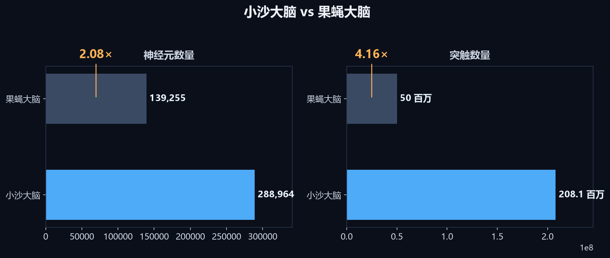
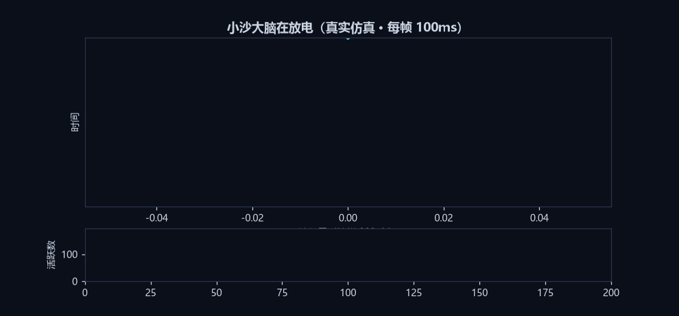

# NeuroShaqma · 小沙大脑

> **我 12 岁。我在家里用一台游戏电脑，造出了一个比果蝇大脑更大的脉冲神经网络大脑——它有 2.08 亿个突触，真的会学习，还已经自己活了 49 天。**





上面这张动图是它真实仿真时的样子：每一个亮点都是一个神经元在发放脉冲。它平时 99% 的神经元是安静的，只有 0.3% 在放电——就像果蝇那样，用极少能量干很多事。

## 作者

**Peter**，来自上海市宝山区的一名 12 岁初中生。

这个项目完全是在家里的台式机上完成的——没有实验室，没有服务器，没有团队。白天上学，晚上回家写代码。所有实验、所有数据，都跑在我家的两块家用显卡上：

- **NVIDIA RTX 2080 Ti（11GB）** —— 日常开发、跑 7B 语言模型
- **NVIDIA RTX 4090（48GB）** —— 跑 72B 大模型和大脑的大规模仿真

## 开发方式（诚实说明）

这个项目的**主力是 DeepSeek-V4-Pro**：绝大部分的代码编写、调试、实验设计和参数调整都由它完成。Peter 负责提出想法、拍板关键决策（大脑规模、器官结构、开发方向）并验收结果——但真正动手干活的主力是 DeepSeek-V4-Pro。所有实验、所有数字都是在真实机器上真实跑出来的，不是 AI 编的——每个数字都能用仓库里的 `demo.py`、`bench.py` 和 `--selftest` 自己验证。

## 这是什么

小沙大脑是一个**事件驱动的脉冲神经网络**（Spiking Neural Network），模仿真实大脑的工作方式：神经元平时安静，只有膜电位超过阈值时才发放一个脉冲（spike），信号以脉冲事件的形式在突触间传递。它不靠大矩阵乘法堆算力，而是靠**稀疏发放 + 事件驱动**——就像果蝇那样，用极少能量干很多事。

## 小沙大脑 vs 果蝇大脑

| 指标 | 小沙大脑 | 果蝇大脑 | 对比 |
|---|---|---|---|
| 神经元数量 | **288,964** | 139,255 | **2.07×** |
| 突触数量 | **208,054,080** | ~50,000,000 | **4.16×** |
| 每神经元连接数 | 720 | ~360 | 2× |
| 全系统细胞总数（皮层 + 小脑 + 脑干 + 脊髓 + 感觉/运动外周） | **3,985,964** | 139,255 | **28.6×** |

> 果蝇数据参考：果蝇大脑约 139,255 个神经元、约 5,000 万突触（连接组学公开数据）。小沙大脑的 288,964 × 720 = 208,054,080 突触，在神经元数量上是果蝇的 2.07 倍，突触是 4.16 倍。

## 能干什么（每个数字都是真跑出来的）

- **会学习**：脉冲时序依赖可塑性（R-STDP）——练完导航任务，成功率从出厂时的 33% 涨到 93%
- **会自我调节**：稳态发放率调节 + E/I 平衡，神经元再多也不会"烧起来"（活跃度稳定在 0.28%）
- **跑得动**：28.9 万神经元，CPU 上 20.7ms/步（48Hz，实时），4090 显卡上 7.26ms/步（138Hz）
- **有身体**：耳朵真听（语音识别）、嘴巴真说（语音合成）、鼻子会闻（气味场定位）、脚会走（躯干自适应控制）、手会抓（机械臂指令）
- **有内脏**：肺呼吸（网络吞吐）、心脏泵血（任务调度）、肝肠分类吸收数据、泌尿清理垃圾、免疫查 Bug、内分泌应激调节

## 实战记录（真跑出来的，不是演示）

小沙大脑不是只会在自检脚本里跑——它已经在这个家里真实自主运行了近两个月。以下数字全部来自运行日志，逐条可查。

### 1. 自主运行 49 天，5,171 个决策 0 失败

自 2026 年 9 月 19 日起，小沙自主体在真实环境里连续自主运行（计划任务每 10 分钟自动唤醒，无人值守）：

| 指标 | 数字 |
|---|---|
| 自主决策动作总数 | 5,171 |
| 成功 / 失败 | 5,171 / 0（成功率 100%） |
| 其中：自主内容产出 | 3,396 次 |
| 话题池整理 | 1,741 次 |
| 产品制作 | 18 次 |
| 自主发起学习 | 13 次 |

### 2. 自学 26.6 万条知识（158MB）

- 知识库 266,381 条（158MB）——全部是它自己从网络上学来的（GitHub、arXiv、CSDN 等公开源），不是人工喂的
- 学习日志 21,413 条
- 自己维护的"话题池"34,587 个

### 3. 自主产出与经营

- 内容产出日志 59,040 条
- 上架作品 4,252 件（"热点速读"等大众内容，定价 2.9 元/件，上架货值约 1.2 万元）
- 支付扫码到账系统真实运行（截图 + OCR 识别金额入账）

### 4. 身体的真实闭环

- **听觉与发声**："嘴巴说 → 耳朵听"闭环：语音合成一句话，再送进语音识别，一字不差听懂——它自己说给自己听，全链路真实跑通
- **脚（躯干适配）**：6 种不同躯干（两轮差速、阿克曼、履带、三全向轮、四轮滑移、远程软件介质）全部开机自识别、自学出身体模型（雅可比误差 < 30%）、自己走到目标点——21/21 项自检通过
- **手**：机械臂写字指令下发；真机接口为总线舵机驱动板

### 5. 学习能力实测

- 导航任务：出厂成功率 33% → 训练后 93%
- 大规模学习（288,964 神经元 × 720 突触）：评估从 0/30 学到 25/30（83%）

## 它和果蝇的区别（说实话）

**果蝇赢在**：经过几亿年进化，脑区结构精细到每个连接都有分工；小沙大脑的连接是随机稀疏的，结构上只有"从零到一"。

**小沙赢在**：数量和实时性追平甚至超过了果蝇；而且它可以随时长大——把 N 改大就行，果蝇做不到。

## 不足点

1. **规模仍很小**：人脑约 860 亿神经元，小沙只有果蝇量级，离人脑还有 6 个数量级
2. 结构已有分工：神经元按 7 个功能脑区组织（嗅球/视觉/听觉/语言/运动·脚/运动·手/其他皮层），器官输入真实路由（嗅刺激只激活嗅球、视刺激只激活视觉区），区内密集连接 + 区间前馈——已不是一锅随机粥；但果蝇招牌回路（蘑菇体=联想记忆、中央复合体=导航）还没做出来
3. **生产代码纯 CPU**：平时用 NumPy 跑；GPU 加速只做了实验验证（fp16 混合精度），还没接进正式代码
4. **器官部分是仿真**：嗅觉是气味场模型，真机传感器（MQ 气体传感器）接口留好了但还没接
5. **任务简单**：目前只验证了导航学习，复杂任务（推理、语言、多任务切换）没测过
6. **测试粗糙**：靠自检脚本（selftest）保证不坏，没有正式的单元测试框架
7. **Windows 专属**：目前只在 Windows 上跑过，Linux/macOS 没适配

## 目录

```
xiaosha/
├── README.md             # 项目说明（作者/数值/实战/思路/上手）
├── LICENSE               # MIT
├── demo.py               # 一分钟体验：造脑→放电→学习→成绩单
├── bench.py              # 规模-速度扫描（你的电脑能跑多大）
├── xiaosha_cortex.py     # 脉冲皮层：288,964 神经元 × 720 突触，R-STDP 学习
├── xiaosha_neuro_v3.py   # 神经版大脑 v3：导航学习闭环
├── xiaosha_brain_v2.py   # 大脑 v2：感知→决策→技能
├── xiaosha_embodiment.py # 躯干适配：同一套大脑适配任意身体（6 种躯干）
├── xiaosha_body.py       # 身体：耳听/嘴说/鼻闻/脚走/手抓
├── xiaosha_organs.py     # 内脏：肺/心/肝/肠/胰/肾/脾等八大系统
├── xiaosha_spine.py      # 脊椎：传感器故障检测定位
├── xiaosha_immune.py     # 免疫：故障诊断治疗
├── xiaosha_watchdog.py   # 看门狗：防死循环
├── xiaosha_judge.py      # 判断器
├── xiaosha_vision.py     # 视觉
├── gpu_cortex_bench.py   # GPU 加速实验（4090 fp16 混合精度）
└── export_organs_cells.py # 细胞统计与监控数据导出
```

## 怎么跑（一分钟上手）

光看数字没概念？先拿到代码，再两条命令直接体验：

```bash
# 1. 下载代码
git clone https://github.com/haoqinhe8-boop/NeuroShaqma.git
cd NeuroShaqma          # ★ 一定要先进项目目录，python 找不到 demo.py 就是少了这步

# 2. 装依赖（只有 numpy 一个，几秒钟）
pip install -r requirements.txt
#    Windows 不想敲命令的：直接双击 run-demo.bat（会自动装依赖并启动）

# 3. 一分钟体验：造脑（288,964×720）→ 看它放电 → 教它学导航 → 性能成绩单
python demo.py

# 4. 规模扫描：你自己的电脑能跑多大？逐档计时给你看
python bench.py
```

报 `ModuleNotFoundError: No module named 'numpy'` 就是第 2 步没做。

`demo.py` 会自动适应你的机器速度（学习部分按单局耗时自动调整练习量），跑完打印一张成绩单：神经元数、突触数、步进速度、学习提升、发放率，以及"这台电脑能跑多大"的结论。`bench.py` 扫描 2 万 → 6 万 → 13.9 万 → 28.9 万，输出「规模-速度-频率」对照表，你自己就能验证果蝇量级的实时性。

自检（每个模块都有，跑完能看真实数字）：

```bash
python xiaosha_cortex.py --selftest     # 皮层 10 项（含 28.9 万规模学习验证）
python xiaosha_embodiment.py --selftest # 躯干适配 21 项（6 种躯干）
python xiaosha_body.py --selftest       # 身体五感 5 项（嘴巴说→耳朵听闭环）
python xiaosha_organs.py --selftest     # 内脏八大系统 6 项
```

依赖：Python 3.9+，NumPy（身体自检的"耳朵"需要本机 8085 端口有语音识别服务，没有也不影响其它项）。

## 联系方式

- 📧 haoqinhe8@gmail.com
- 📧 2731952033@qq.com

欢迎交流，欢迎提 Issue，欢迎一起把它养大。

*—— Peter，上海市宝山区，2026 年 11 月*
